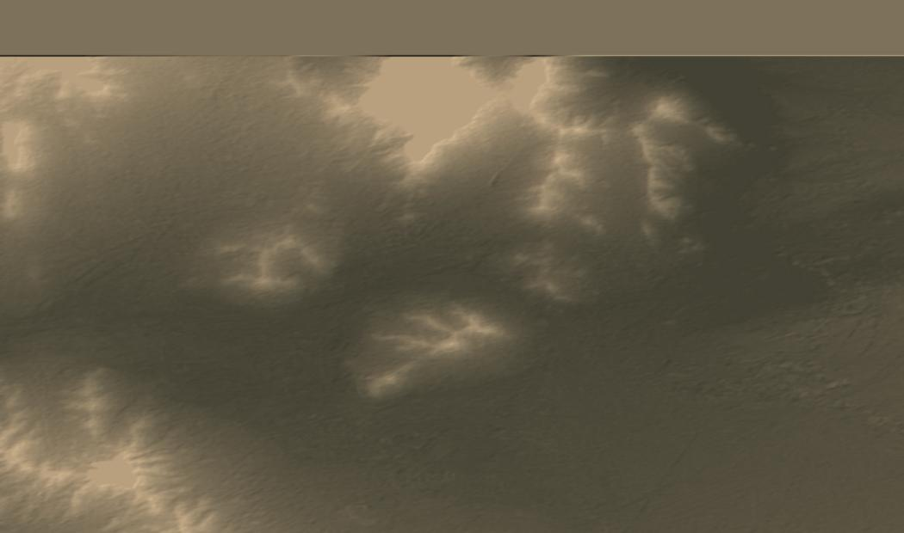
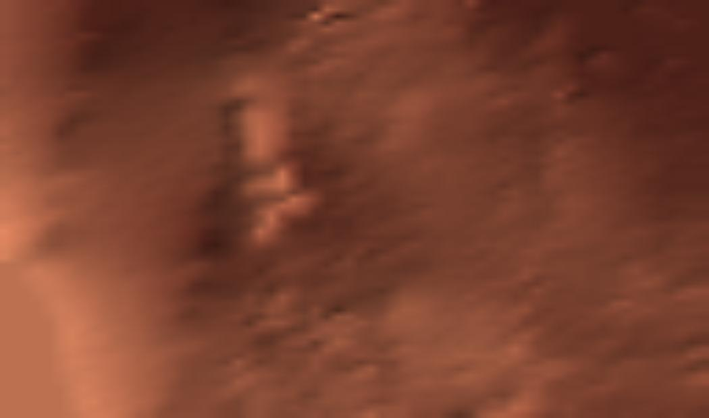
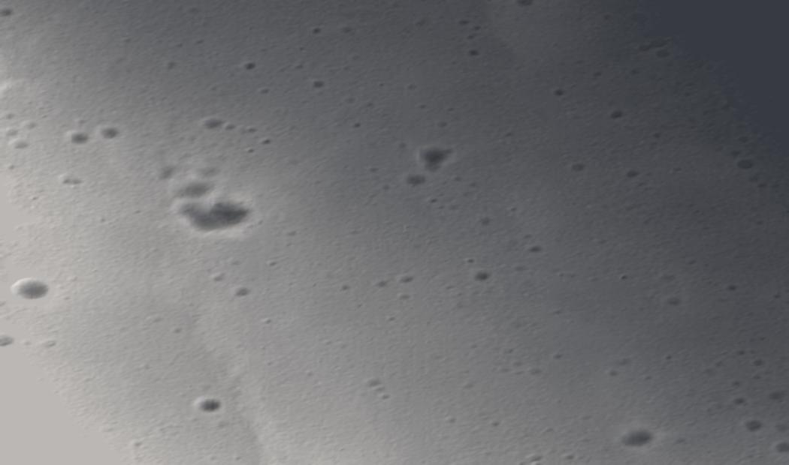

# 🌎 TerraMatch Chile
### Explore Earth. Understand Other Worlds.

**FINAL SUBMISSION VERSION · NASA SPACE APPS CHALLENGE 2026**

**Team Joseadores | Universidad de La Frontera (UFRO) | Temuco, Chile**

**Selected challenge:** *Identify Earth Locations that Analog the Permanent Moon Base Locations and Mars*

[Explore the final application code](app.py) · [Review scientific results](results/README.md) · [Inspect validated claims](docs/validation/AFIRMACIONES_Y_EVIDENCIA.md) · [Leer en español](#resumen-en-español)

> **This repository contains the final TerraMatch Chile v2 submission package.** It includes the bilingual interactive interface, the original v0.7 scientific result files, site geometries, data provenance and evidence documentation. **This is an independent student-team submission, not a NASA-endorsed application.** Results are exploratory and limited to the pilot coverage.

---

## 01 · The project

**TerraMatch Chile** is an interactive geospatial research prototype for identifying and explaining **partial topographic similarities** between selected environments in Chile and reference terrains on **Mars and the Moon**. It combines open planetary and terrestrial elevation data with environmental eligibility filters, comparable terrain metrics, scientific validation, and an accessible bilingual interface.

**Research question:** *Which environments in Chile share measurable characteristics with selected terrains on Mars and the Moon, in what ways are they similar or different, and what could make them useful for future research or mission preparation?*

Our aim is **not** to claim that any Chilean site is identical to a planetary environment. The tool helps researchers ask better questions, understand limitations, and prioritize **future investigation**, not choose landing sites.

| Earth · ASTER GDEM v3 | Mars · MOLA MEGDR | Moon · SLDEM2015 |
| :---: | :---: | :---: |
|  |  |  |
| Chilean pilot terrain | Western Elysium Planitia | Mare Tranquillitatis |

*Images are shaded-relief visualizations derived from elevation data, **not photographs**. [Credits and attribution](assets/visuals/ATTRIBUTION.md).*

## 02 · What's included in the final v2

The final **Streamlit** application is available in **English and Spanish**. It improves the presentation of the science without changing the underlying analysis:

- **Animated landing experience** with a planetary visual identity and gentle transitions, including reduced-motion support.
- **Guided mission explorer:** choose Mars or the Moon, preview a Chilean pilot site, and navigate to its regional map.
- **Interactive pilot maps** with filters, score/coverage views, site markers and a corrected regional view around **Llaima**.
- **Terrain comparator:** inspect slope, local relief and roughness for each pilot site alongside its planetary reference.
- **Interactive validation charts:** distinguish the Martian percentile benchmarks from lunar similarity scores.
- **Five site profiles,** supporting observations, explicit uncertainties, and an accessible **Use of Artificial Intelligence** disclosure.

The source code for these features is in [`app.py`](app.py), [`ui_data.py`](ui_data.py) and [`v2_components.py`](v2_components.py). Visual animations and interactivity **do not recompute or alter scientific results**.

## 03 · How the model works

| Data source | Role |
| --- | --- |
| **ASTER GDEM v3** (NASA Earth observation) | Terrain elevation for the Chilean pilot sites |
| **MOLA MEGDR** (NASA Mars Global Surveyor) | Martian reference terrain in **Elysium Planitia** |
| **SLDEM2015** (LOLA + Kaguya) | Lunar reference terrain in **Mare Tranquillitatis** |
| **GPM IMERG Final V07** (NASA) | Aridity eligibility screen for the Mars profile |
| **SERNAGEOMIN geology** | Preliminary volcanic-unit eligibility screen for the Moon profile |
| **Chilean reference boundaries** | Geographic context for the exploratory study |

The model harmonizes topography to an approximate **463 m effective resolution** and compares **5 km windows** using three variables: **90th-percentile slope**, **local relief (elevation P95–P5)** and **roughness (standard deviation of slope)**.

Environmental screens determine which cells are **eligible** to receive a score. For eligible cells, the original v0.7 analysis assigns a topographic similarity score **S (0–100)** and assesses rank sensitivity with **500 Monte Carlo iterations**. A score of 100 is **not** a claim of complete planetary similarity.

Scientific methodology and original processing pipeline: [TerraMatch Chile scientific repository](https://github.com/martizng/terramatch-chile) · [Detailed methodology](https://github.com/martizng/terramatch-chile/blob/main/docs/methodology.md) · [Motor v0.7 results](https://github.com/martizng/terramatch-chile/blob/main/docs/engine_v07/RESULTADOS_v0.7.md).

## 04 · Scientific results — pilot scope

**Geographic coverage:** **four ASTER GDEM v3 tiles**, not all of Chile. The study defines a reference grid of 31,660 cells, of which **1,262** have processed ASTER terrain metrics. **895** cells received a valid Mars score and **256** received a valid Moon score.

| Site / test | Original result | What we can conclude |
| --- | --- | --- |
| Yungay · Mars | **47.4th percentile** | Did **not** meet the expected ≥75th-percentile terrain benchmark |
| Salar de Pajonales · Mars | **63.1st percentile** | Did **not** meet the expected ≥75th-percentile terrain benchmark |
| Llullaillaco · Mars | **8.3rd percentile** | Passed the predefined negative-control criterion |
| Steep-terrain control · Mars | **2.5th percentile** | Passed the negative-control criterion |
| Llaima lava-flow sector · Moon | **S ≈ 39.0** | More similar to the lunar reference **than the cone**, within this pilot metric |
| Llaima cone · Moon | **S ≈ 17.2** | Internal reference for the relative terrain comparison |

**The results matter even when a benchmark fails.** Yungay and Pajonales may be relevant for aridity-related questions, but are not close topographic matches to Elysium at this resolution. The mapped Llaima lava-flow sector scores above the cone, **not** because it has been demonstrated to be lunar terrain.

**All five study sites have LOW site-level confidence.** Some individual grid cells have different confidence classifications, which must not be confused with the five site summaries. The high-scoring pilot cell near **24.5° S, 68.9° W** remains **unidentified as a specific landform**.

[Explore Mars results](results/mars_scores_web.csv) · [Explore Moon results](results/moon_scores_web.csv) · [Five-site summary](results/sites_summary.csv) · [Validation and sensitivity checks](results/validation.json) · [Claims and evidence](docs/validation/AFIRMACIONES_Y_EVIDENCIA.md).

## 05 · Limitations and scientific responsibility

- **No national ranking:** only four ASTER pilot tiles were processed. Expanding coverage may change normalization, percentiles and rankings.
- **MOLA coverage:** just **5 of 25** Martian profile windows met the direct-observation criterion; interpolation affects interpretation.
- **IMERG precipitation uncertainty:** precipitation estimates can be biased in hyper-arid areas; alternative CR2MET-based screening produced similar reference-site percentiles but does not remove uncertainty.
- **Preliminary geological mapping:** the Moon eligibility filter uses a **1:1,000,000-scale** third-party geological copy. Pajonales and Llaima lava-flow polygons are **geological proxies**, not confirmed precise landform boundaries.
- **Scope of inference:** topographic similarity does **not** establish equivalent geology, atmosphere, thermal conditions, habitability, landing safety or operational suitability.
- **Missing and excluded cells:** cells without valid data or failing eligibility screens are **not assigned a similarity score**. Blank areas on the maps do not mean low similarity.

These limitations are visible in the application and form part of the scientific findings.

## 06 · Use of Artificial Intelligence

- **Claude and Claude Code (Anthropic), analysis lead.** Used to draft the code of the analysis engine (grid, relief variables, similarity, Monte Carlo, validation), the synthetic-data logic tests, the GIS support scripts (BCN quality control, ASTER download and mosaic, IMERG climatology, CR2MET merge, volcanic-unit raster), the figures and parts of the technical documentation. Claude Code also helped locate and download the public copy of the SERNAGEOMIN geological map. All code was reviewed and run by the team on their own computers with real data. Code files carry an "AI-Assisted" header and every use is logged in AI_LOG.md.
- **Claude (Anthropic), coordinator.** Used to draft and edit the project summary, detailed description, demo script and submission checklists from the team's technical document and result files.
- **ChatGPT (OpenAI), web development support.** Used to assist in the creation and development of the project's website, including its structure, interface design, layout, and code implementation. The team reviewed and integrated the generated code to ensure the website accurately presents the project's methodology, analysis, and results.
- **AI usage transparency.** No data values or results were generated by AI. All scores come from processing the NASA and Chilean datasets listed above; the synthetic data in the tests checks logic only and is never shown as a result.

[AI work log (original scientific repository)](https://github.com/martizng/terramatch-chile/blob/main/docs/engine_v07/AI_LOG.md).

## 07 · Run the final application

This repository contains the **complete final v2 visualization package**, including the CSV/JSON results required to display the findings. No API keys or Streamlit secrets are required by the included application code.

~~~bash
python -m pip install -r requirements.txt
python -m streamlit run app.py
~~~

To publish a separate web deployment in **Streamlit Community Cloud**, select this repository, the **`main`** branch, and **`app.py`** as the entry point. The dependencies are in [`requirements.txt`](requirements.txt). A specific Python version is not pinned in this repository.

| File or folder | Purpose |
| --- | --- |
| [`app.py`](app.py) | Final bilingual Streamlit interface and AI disclosure |
| [`v2_components.py`](v2_components.py) | Animated visual experience, guided mission explorer and interactive charts |
| [`ui_data.py`](ui_data.py) | Data loading, cartography and Llaima regional map |
| [`results/`](results/README.md) | Unmodified scientific scores, site summaries, Monte Carlo and validation results |
| [`data/targets.json`](data/targets.json) | Planetary reference profiles |
| [`data/chile/sites/`](data/chile/sites/) | Pilot site geometries and preliminary boundaries |
| [`assets/visuals/`](assets/visuals/ATTRIBUTION.md) | DEM-derived figures and attribution |
| [`tests/test_v2_data_integrity.py`](tests/test_v2_data_integrity.py) | Data-integrity regression checks |
| [`docs/validation/AFIRMACIONES_Y_EVIDENCIA.md`](docs/validation/AFIRMACIONES_Y_EVIDENCIA.md) | Team-approved scientific claims |

The stored v0.7 results and site boundaries are identical to those in the original project repository. Some large original geospatial raster inputs are held outside this visualization repository and are required to reproduce the *entire* analysis from raw data, but **not** to launch the published-data web interface.

## Resumen en español

**TerraMatch Chile — versión final de presentación para NASA Space Apps Challenge 2026**, desarrollada por el **equipo Joseadores de la Universidad de La Frontera, Temuco, Chile**.

Esta plataforma geoespacial interactiva y bilingüe permite explorar semejanzas **topográficas parciales** entre paisajes de Chile y regiones seleccionadas de **Marte (Elysium Planitia)** y **la Luna (Mare Tranquillitatis)**. Incluye mapas, navegación guiada, comparaciones de terreno, visualizaciones animadas, resultados reales y explicaciones de sus incertidumbres.

La investigación utiliza **cuatro teselas ASTER piloto**: se procesaron **1.262 celdas con datos topográficos**, con **895 celdas puntuadas para Marte** y **256 para la Luna**. No se trata de un ranking nacional ni de una certificación de análogos planetarios. Los cinco sectores evaluados presentan **confianza baja** y las delimitaciones geológicas preliminares requieren validación adicional.

Los resultados científicos no fueron generados ni ajustados por IA; su uso en código, documentación y desarrollo web se declara en este README.

**La presente versión se entrega para evaluación del desafío; no implica aprobación, afiliación ni respaldo oficial de NASA.**

---

**Team Joseadores · TerraMatch Chile · NASA Space Apps Challenge 2026**  
*Final student-team submission · Explainable terrain comparisons · Open science · Scientific limitations disclosed*
